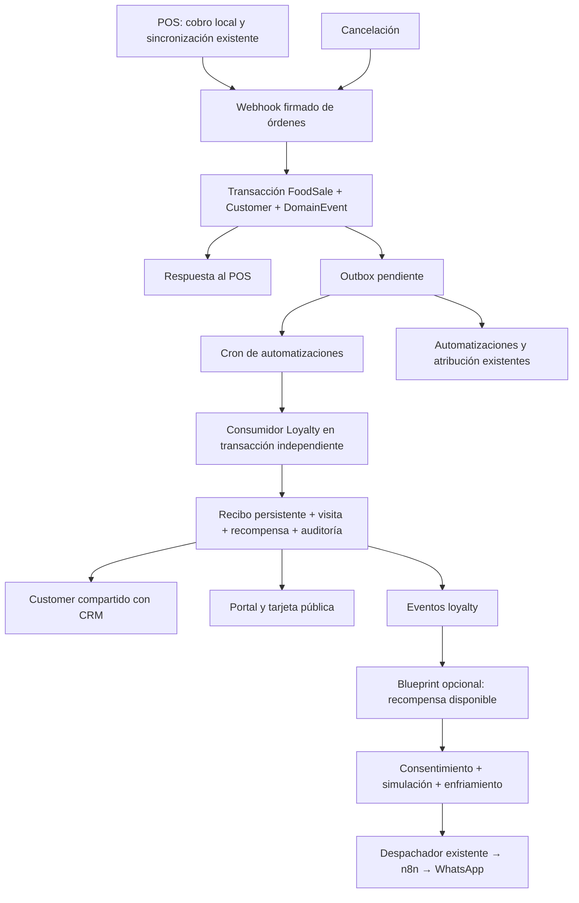

# Integración de Food Loyalty en ReymenApp

Fecha: 2026-10-14. Rama de trabajo: `codex/food-loyalty-integration`.
Base examinada: `main` en `54bfa5700adbb51b8e5c1062079842be5dab5352`.
Demo examinada e integrada: `feature/food-loyalty-demo` en `dff9a9a48a10e114bbaf96a3756b7e9100e6d629`.

## Resultado y alcance

Integración local del módulo nativo `LOYALTY`: portal, administración comercial, registro público, clientes, visitas, recompensas y consumo asíncrono de ventas. No se desplegó, no se migró producción, no se habilitó para organizaciones reales, no se modificaron ReymenPOS, Reymen-Web ni SmartCard. El estado de los servicios externos no se presenta como validado.

Se realizó un merge de tres vías sobre el `main` actual, conservando sus cambios de seguridad, planes, facturación, CRM y automatizaciones. Los conflictos en esquema, variables de ejemplo y proxy se resolvieron conservando ambas funcionalidades. Se reemplazó la integración síncrona de ventas de la demo por un consumidor del outbox existente. No se sustituyó `main` por los archivos antiguos de la demo.

## Las cinco respuestas arquitectónicas

| Pregunta | Hallazgo y decisión | Evidencia |
|---|---|---|
| ¿Servicio independiente? | Código dentro de ReymenApp, Next.js y Prisma, misma base PostgreSQL, sesión y organización. No se necesita Supabase para Loyalty. | `prisma/schema.prisma`, `src/lib/loyalty/context.ts`, `src/actions/loyalty.ts` |
| ¿Identidad? | `LoyaltyMember.customerId` referencia al `Customer` del negocio. Inscripción con teléfono normalizado, único por programa; también se exige unicidad programa/Customer. El QR contiene un token aleatorio de 24 caracteres, no el teléfono. El POS usa el `Customer` ya incluido en la venta. | `src/lib/customers.ts`, `src/lib/loyalty/service.ts`, `src/lib/loyalty/token.ts` |
| ¿Dónde acumula? | En ReymenApp. `processFoodPosOrder` confirma venta y evento; el cron consume `sale.completed` en otra transacción y registra una visita. El cobro no llama al módulo, al worker ni a n8n. | `src/lib/food.ts`, `src/lib/domain-events.ts`, `src/lib/automation-tick.ts`, `src/lib/loyalty/events.ts` |
| ¿Reglas? | Sellos por visita, meta configurable, recompensa descrita como artículo gratis, descuento porcentual, descuento fijo o personalizada. El tipo es descriptivo: no es un motor de precios. Hay programa por organización con alcance global o una sucursal, versiones, pausa, canje y enfriamiento de tres minutos. No hay puntos por importe, niveles, caducidad ni catálogo múltiple de premios. No se inventaron. | `src/lib/loyalty/cycle.ts`, `service.ts`, modelos `LoyaltyProgramVersion`, `LoyaltyVisit`, `LoyaltyReward` |
| ¿Datos de venta? | ID de venta, organización, pedido externo estable cuando existe, `customerId`, fecha, sucursal, importe bruto y referencia de cancelación. Importe positivo = visita elegible; el monto sirve para estadísticas, no multiplica sellos. Productos, impuestos y moneda adicional no son requisitos de esta mecánica. `netAmount` y descuentos continúan en FoodSale y los eventos existentes. | `src/lib/food.ts` (`saleFact`), `src/lib/loyalty/events.ts` |

El programa de la demo no representa un programa de puntos ni niveles VIP. `customer.vip`, cumpleaños, segunda visita y recuperación siguen usando sus reglas y estadísticas de Customer; no se alteraron para equiparar un sello a una visita comercial ni para prometer beneficios inexistentes.

## Flujo final

El tick conserva el candado global de PostgreSQL existente. Se ejecuta periódicamente mediante el cron ya documentado en `docs/automations/ARQUITECTURA.md`; no se creó otro scheduler. La visita puede tardar hasta la siguiente ejecución y sus reintentos. La respuesta del webhook no promete saldo actualizado inmediatamente.

## Persistencia, idempotencia y recuperación

- `LoyaltyEventReceipt` guarda organización, event ID, tipo, venta, resultado y fecha. No tiene FK hacia DomainEvent: la retención del outbox no elimina la protección contra replays.
- `LoyaltyVisit` conserva una clave única organización/operación y otra organización/venta. Para POS se usa `pos:<orderId>` o `pos:<saleId>`; el portal usa `manual:<requestId>`. Un evento distinto para el mismo pedido tampoco genera otro sello.
- Candado advisory por organización/pedido serializa venta y cancelación; `FOR UPDATE` del miembro serializa visitas, conciliación y canje. Cambios de saldo, recibo, auditoría y nuevos eventos se confirman juntos.
- La consulta puntual de FoodSale valida el hecho y sus relaciones. No se escanea la tabla para descubrir ventas nuevas ni se ejecuta un backfill.
- Solo hay acumulación para miembros ya inscritos y ventas posteriores al alta del miembro, creación del programa y habilitación del módulo. Venta anónima/no inscrita queda omitida; inscribirse después no transforma compras anteriores en sellos.
- Pausa, sucursal ajena al programa y enfriamiento son omisiones de negocio con motivo persistente. El enfriamiento usa visitas a menos de tres minutos a ambos lados de la fecha, por lo que recibir una visita anterior no la descarta solo por ser anterior. Dentro de esa ventana gana la primera operación procesada.
- Una venta retrasada usa la regla vigente al procesarse; la versión utilizada se guarda en la visita. Las recompensas cerradas mantienen su snapshot. No se ha construido un historial temporal de habilitaciones/pausas para reconstruir decisiones pasadas.
- Fallos técnicos propagan al outbox existente: backoff y hasta cinco intentos. En Programa, un gerente puede reencolar eventos `FAILED` de ventas de su organización. Los recibos ya confirmados impiden duplicaciones y los otros consumidores conservan su propia idempotencia.
- En el perfil del miembro, **Conciliar historial** reconstruye totales, fechas, avance y déficit desde movimientos confirmados y recompensas. No crea visitas a partir de ventas históricas.
- Se registran IDs y motivos de operaciones; no se añade teléfono, token QR ni datos de contacto a los logs de Loyalty.

### Cancelaciones y devolución de beneficios

La venta original puede llegar antes o después de su cancelación. Si la cancelación llegó primero, el consumidor de la venta encuentra ese hecho y no concede un beneficio inexistente. Si ya existe una visita, queda `VOIDED`; no se borra.

Cada visita permanece asignada a su ciclo histórico. Al cancelar una de un ciclo cerrado:

1. Una recompensa disponible se anula si el ciclo queda incompleto.
2. Una recompensa ya canjeada sigue registrada como `REDEEMED`: un artículo entregado no puede recuperarse mediante una escritura en base de datos. Se registra `missingVisits` y el miembro muestra `deficitVisits`.
3. Las siguientes visitas compensan primero los ciclos incompletos, con su meta y premio originales. Una recompensa anulada puede volver a estar disponible con el mismo ID; una ya entregada no se entrega nuevamente.
4. Los otros ciclos cerrados no pierden sus visitas ni se reescribe su premio. Conciliar/reintentar no crea otra recompensa para el mismo ciclo.

La política de compensación es visible en el perfil y tarjeta; no se deja el saldo incorrecto con un simple `needsReview` como en la demo.

**Devoluciones parciales:** si queda importe positivo, se conserva una visita y se ajusta su monto estadístico; al agotarse el importe se anula. El productor actual deduplica cancelaciones por `orderId + grossAmount`, sin un identificador de devolución. Por ello dos devoluciones legítimas del mismo importe sobre el mismo pedido son indistinguibles de reintentos. No se afirma soporte completo para ese escenario. Se necesita un `refundId` estable generado por el POS y un cambio coordinado del contrato para soportarlo; no se modificó otro repositorio ni se cambió silenciosamente la deduplicación existente. Las pruebas cubren cancelación completa y parciales de importes distintos.

### Precisión e integridad

Importes persistidos como `Decimal(12,2)`; sumas y devoluciones con Prisma Decimal. Captura manual redondeada a centavos y limitada al rango existente. Restricciones de base: saldos/contadores no negativos, meta positiva y déficit acotado, importe de visita positivo o ausente. Una venta ligada a una visita no puede borrarse por FK `RESTRICT`. El purgado de ventas de prueba muestra un error antes de tocar ese historial.

## Acceso y experiencia

- `LOYALTY` es independiente de `FOOD_OPS`; funciona con visitas manuales sin contratar POS.
- Admin → Planes usa el enum completo para validación y `ALL_MODULES` para selección. Agregar el módulo al enum no activa organizaciones ni altera paquetes existentes.
- Portal: una entrada **Lealtad / Loyalty**, pestañas Resumen, Programa, Clientes, Visitas, Mapa, Analytics y perfil del miembro.
- Ver requiere sesión organizacional y módulo; modificar configuración requiere `loyalty:manage` (dueño, gerente o administrador); operar requiere `loyalty:operate` (incluye agente). Visor no registra ni canjea. Las acciones vuelven a validar en servidor.
- Suspender quita acceso a páginas, acciones, búsqueda POS y tarjeta pública sin borrar miembros ni premios. Las reversiones de ventas ya premiadas siguen corrigiendo el historial aunque el módulo esté suspendido.
- Carga y error tienen estados propios, reintento de error usa la API actual de Next.js, formularios muestran estado/resultado y el canje pide confirmación. Se reutilizan componentes, i18n y estilos claro/oscuro existentes.
- En Clientes del negocio aparece el vínculo a su membresía; desde el perfil de Loyalty se puede abrir su contacto CRM cuando existe y CRM está habilitado.
- Los datos de clientes son reales. Se desactivó la localización ficticia por CP de la demo. El mapa muestra sucursales configuradas; tablas y métricas por CP funcionan sin inventar distancias o zonas de oportunidad. Hace falta un catálogo geográfico verificado para colocar CP en el mapa.

## Consentimiento, QR y automatizaciones

La aceptación del registro (`loyalty-enroll-v2`) permite administrar la membresía; no activa `Customer.consentAccepted`. La captura de consentimiento comercial existente en el POS sigue siendo la fuente para comunicaciones. Al inscribir un teléfono existente no se cambia su nombre ni su consentimiento con los datos de un visitante público. No se crea otro Lead automáticamente.

La tarjeta usa token aleatorio, no es indexable y saluda por primer nombre; no devuelve el número/correo. Un registro repetido no revela el token anterior. Inscripción tiene límites por IP y teléfono. Poseer la tarjeta permite verla, **no canjear**. Canje es una acción autenticada y autorizada del portal; el descuento físico/aplicado al ticket se gestiona operativamente, no se inventa un ajuste automático de precios.

Eventos nuevos: `loyalty.visit_earned`, `loyalty.visit_reversed`, `loyalty.reward_unlocked`, `loyalty.reward_redeemed`. No se agregaron eventos de puntos, niveles o vencimientos sin implementación. El consumidor solo atiende ventas, de modo que no realimenta sus propios eventos.

Blueprint `loyalty_reward_unlocked` disponible para activación explícita, con simulación, cooldown, horario y consentimiento del motor existente. No se instala automáticamente. Usa el despachador genérico `action.message.send`, plantilla externa `loyalty_reward_unlocked_v1`, variables `name`, `businessName`, `rewardName`. Antes de entregar vuelve a comprobar consentimiento, módulos, organización activa y disponibilidad del premio. No se envían campañas desde segmentos del mapa.

**Pendiente externo:** preparar/verificar esa plantilla y credenciales en n8n/WhatsApp. Las pruebas locales simulan caída de n8n y retirada de consentimiento; no constituyen evidencia de entrega real. Los otros blueprints siguen funcionando sin depender de Loyalty y pueden reutilizar el Customer asociado; no se añadieron premios de cumpleaños, niveles ni puntos ficticios.

## Contratos externos y límites

- `POST /api/webhooks/pos/orders`: mismo contrato existente, sin requisito de `loyalty`. El evento añade `cancelsSaleId`. La respuesta no incluye saldo/recompensa síncrona.
- `POST /api/webhooks/pos/loyalty`: consulta opcional firmada HMAC, timestamp, organización activa, módulo y límite de frecuencia. Acepta `{code}` o `{phone}` y devuelve identificación mínima/progreso/recompensas. No registra visitas, descuentos ni canjes. El bloque antiguo `redeemRewardId` no concede valor.
- SmartCard: se inspeccionó `src/app/api/webhooks/smartcard/leads/route.ts` y los contratos locales. Su webhook resuelve empresa → organización y crea leads; no acredita puntos ni autentica miembros. Una NFC puede abrir el enlace de inscripción o tarjeta web. Vincular `cardId` → miembro exigiría un contrato autenticado, scoped por organización y consentimiento/identidad verificable en SmartCard; no se implementó ni se envió una escritura a Supabase.
- Apple/Google Wallet no tienen firma de pases, JWT ni actualización implementados. Botones desactivados incluso si se añaden variables, rutas responden 501; las credenciales por sí solas no hacen funcionar una integración.
- No se modificó el cliente ReymenPOS. Su comportamiento offline no se volvió a implementar: las pruebas de ReymenApp demuestran que confirmar ventas no ejecuta Loyalty ni llama a n8n; no son una prueba de terminal física sin red.

## Archivos y migraciones

La UI, rutas públicas, modelos, Leaflet y utilidades de la demo se integran desde su rama. Principales adaptaciones:

| Área | Archivos |
|---|---|
| Esquema | `prisma/schema.prisma` |
| Núcleo | `src/lib/loyalty/service.ts`, `events.ts`, `reconcile.ts`, `pos.ts`, `queries.ts` |
| Worker/contratos | `src/lib/automation-tick.ts`, `src/lib/domain-events.ts`, `src/lib/food.ts` |
| Seguridad/planes | `src/lib/guards.ts`, `permissions.ts`, `modules.ts`, `src/actions/admin/plans.ts`, `src/components/admin/PlanEditorDialog.tsx` |
| Acciones/portal | `src/actions/loyalty*.ts`, `src/app/(portal)/portal/loyalty/`, `src/components/loyalty/`, `src/components/portal/PortalSidebar.tsx` |
| Clientes/CRM | `src/app/(portal)/portal/customers/page.tsx`, perfil de Loyalty |
| Público/POS | `src/app/lealtad/`, `src/app/api/webhooks/pos/loyalty/route.ts`, `src/proxy.ts` |
| Campañas | `src/lib/automation/blueprints/loyalty-reward-unlocked.ts`, índice del catálogo y `dispatcher.ts` |
| Historial | `src/lib/food-purge.ts`, FK de venta |
| Pruebas | `src/lib/loyalty/*.test.ts`, `src/actions/loyalty.test.ts`, pruebas de planes/blueprints, `e2e/loyalty.spec.ts` |

Migraciones heredadas de la rama: `20261023090000_food_loyalty_demo`, `20261024090000_loyalty_module`, `20261025090000_loyalty_locations_pos`. Adiciones posteriores al último timestamp de main: `20261114090000_loyalty_domain_integration` (recibos, índices, déficit), `20261114091000_loyalty_balance_checks` (checks), `20261114092000_loyalty_preserve_sale_history` (FK restrict). No se borran tablas, columnas ni datos.

### Aplicación y reversibilidad

Solo se aplicaron migraciones a PostgreSQL local de pruebas, nunca a producción. Para una futura publicación autorizada:

1. Respaldo verificable y copia de staging; revisar migraciones aplicadas, especialmente si existió un despliegue previo de la demo.
2. Comprobar duplicados en `(programId, customerId)` y `(organizationId, saleId)` no nulos; revisar contadores y montos contra los checks. Los nuevos índices/checks fallan ante datos incoherentes en vez de corregirlos destructivamente.
3. Aplicar con el procedimiento habitual `prisma migrate deploy` en staging; generar cliente Prisma y compilar. Comparar totales de ventas/clientes antes/después y verificar rollback de aplicación.
4. Mantener módulos existentes sin cambios. Habilitar una organización piloto mediante Admin → Planes/entitlements, crear programa, registrar un miembro y verificar venta → tick → visita → cancelación.
5. Si se revierte la aplicación, suspender Loyalty y volver al release anterior conservando las tablas/ledger. No ejecutar migraciones inversas destructivas, ni borrar visitas para “poner saldo en cero”. Una conciliación no otorga ventas históricas.
6. El seed `prisma/seed-loyalty-demo.ts` sigue siendo una herramienta de demostración: **no ejecutarlo en producción**. No se ejecutó durante esta integración.

## Estado por conexión

| Conexión | Estado | Alcance o pendiente |
|---|---|---|
| Navegación, formularios, idiomas, móvil, temas | COMPLETED | Verificación local en Chromium |
| Customer / CRM | COMPLETED | Identidad existente, vínculos y consentimiento separado |
| Ventas → Loyalty y cancelación completa | COMPLETED | Outbox, idempotencia doble, compensación y concurrencia |
| Varias devoluciones iguales del mismo pedido | BLOCKED | Falta refundId en contrato POS existente; no se promete deducirlo |
| Canje desde portal | COMPLETED | Rol, organización, sucursal, candado, auditoría |
| Descuento/canje automático desde terminal POS | PARTIAL | Consulta disponible; cliente POS y protocolo de reserva/canje quedan fuera de este repo |
| Eventos, recuperación y conciliación | COMPLETED | Cron existente + herramientas restringidas |
| Módulos, catálogo de planes y suspensión | COMPLETED | Sin activación masiva |
| Blueprint / simulación / políticas | COMPLETED | Sin autoactivación |
| Entrega real n8n/WhatsApp | BLOCKED | Plantilla/configuración externa y prueba de entrega pendientes |
| Sucursales y métricas por CP | COMPLETED | Datos reales, sin coordenadas simuladas |
| Geolocalización de CP | BLOCKED | Falta catálogo verificado |
| SmartCard como membresía vinculada | BLOCKED | Contrato externo; abrir URL de tarjeta no exige esa integración |
| Apple/Google Wallet | BLOCKED | Implementación y credenciales faltantes; UI desactivada |
| Puntos, tiers, caducidad, premios nuevos de cumpleaños | NOT REQUIRED | No existen en la mecánica inspeccionada |
| Despliegue/migración productiva | NOT REQUIRED | No autorizados ni ejecutados en esta tarea |

## Validación

Los resultados finales y comandos se registran al cierre de esta tarea. Los fallos iniciales se conservaron en logs locales; no se presentan como pasadas ejecuciones que fallaron. El primer recorrido completo encontró traducciones faltantes, una prueba que dependía del orden del catálogo, una fixture de días locales que presupone UTC y una prueba de planes que consultaba el tipo de cambio externo y agotaba 5 s. Se corrigieron las traducciones y la selección por clave; la suite se ejecuta con TZ=UTC y la prueba de planes usa una tasa simulada para comprobar planes sin depender de la red. Las pruebas propias del tipo de cambio permanecen intactas.

### Resultados finales ejecutados

| Verificación | Resultado |
|---|---|
| `TZ=UTC npx vitest run --maxWorkers=2` | **178 archivos, 1.182 pruebas aprobadas**, 0 fallos (210 s). Incluye POS/webhooks, CRM, planes, automatizaciones, permisos, recibos, compensación y concurrencia. |
| `npm run typecheck` | Aprobado; también validado por el build final. |
| `npm run lint` | 0 errores, 48 advertencias del proyecto; no se afirma ausencia de advertencias. |
| `npm run build` | Build final de producción aprobado, rutas generadas y comprobación TypeScript aprobada. |
| `npx prisma validate` | Esquema válido. |
| `prisma migrate deploy` | Migraciones aplicadas únicamente en PostgreSQL local de pruebas. |
| `prisma migrate diff --from-url <DB local de pruebas> --to-schema-datamodel prisma/schema.prisma --exit-code` | Exit 0, `No difference detected`. |
| Playwright Chromium: `loyalty.spec.ts` | 5/5: acceso, configuración, inscripción, móvil 390 px oscuro/inglés, suspensión. |
| Playwright: `customers.spec.ts`, `module-entitlements.spec.ts`, `health.spec.ts` | 6/6 tras corregir la espera de navegación de Clientes. 11 escenarios E2E distintos aprobados en total. |
| `git diff --check` | Sin errores de whitespace ni marcadores de conflicto. |

El recorrido E2E conjunto tuvo inicialmente 10 éxitos y un timeout: la creación del contacto sí terminó, pero la primera compilación de su página tardó 5,1 s, superando los 4 s de la prueba, que volvía a buscar el botón en otra página. Se reemplazó el bucle que repetía la mutación por un solo clic y una expectativa de URL de hasta 15 s. Su repetición aislada pasó en 9,7 s. No se modificó el comportamiento de creación de contactos para superar esa prueba.

Logs de esta sesión disponibles localmente en `/workspace/.onboarding/logs/loyalty-*` (fuera del repositorio); captura revisada `loyalty-mobile-dark.png`. No incluyen una certificación de producción, un test físico de POS offline ni entrega real por servicios externos.

## Diseño de la tarjeta del cliente

En **Lealtad → Programas** cada programa tiene **Diseño de la tarjeta**: color de
la tarjeta, color de acento (los sellos) e ícono (café, pizza, tijeras, etc.),
con combinaciones listas para elegir. Se guarda en `LoyaltyProgram.cardColor`,
`cardAccent` y `cardIcon` (migración `20261124090000_loyalty_card_style`, solo
columnas opcionales); vacío = el diseño de siempre. No cambia la regla, así que
no crea versión nueva. La vista previa y la tarjeta pública usan el mismo
componente (`LoyaltyCardFace`), y el color del texto se elige solo para que se
lea sobre el fondo. Hasta 12 visitas, cada visita se ve como un sello con el ícono.

La página de inscripción (`/lealtad/<negocio>`) y la tarjeta usan el mismo
diseño: el fondo toma el color de la tarjeta, la cabecera muestra el ícono del
programa, la inscripción enseña "Así será tu tarjeta" y el botón usa el color de acento.

## Ubicación de cada código postal en el mapa de clientes

No hay un catálogo oficial de centroides de CP instalado. Cada CP se busca una
sola vez en el geocodificador (su colonia principal según SEPOMEX, o el CP; nunca
el municipio solo) y se guarda en `PostalCodePoint` (tabla compartida, dato
público; migración `20261124091000_postal_code_points`). En cada carga del mapa
se ubican hasta 3 CP nuevos antes de responder y hasta 25 más después; un CP que
no se encontró se reintenta a los 7 días (`src/lib/geo/postal-points.ts`). Con
eso se dibujan las zonas y se calcula la distancia a la sucursal.
