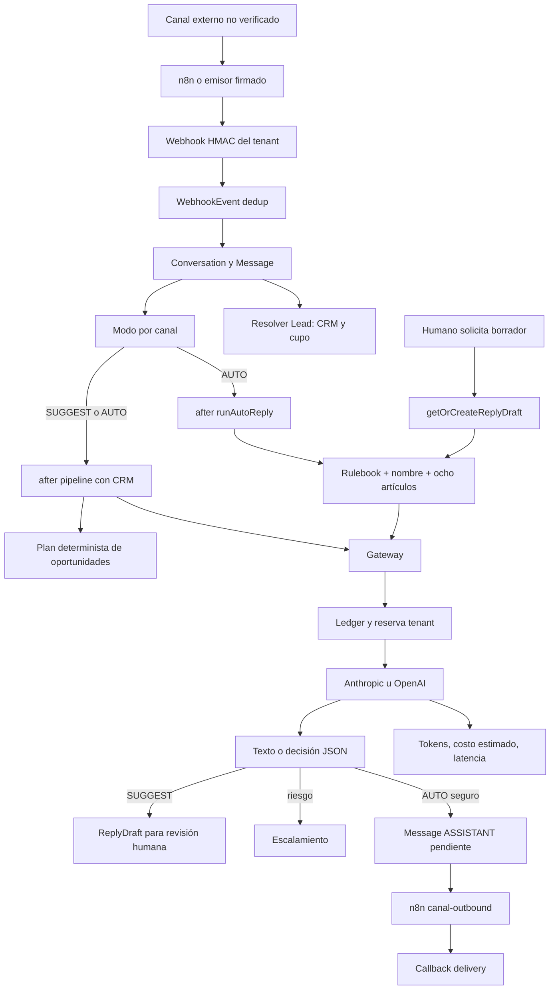

# 01 — Auditoría del estado actual

Snapshot, alcance y niveles C/P/I/V en [README](README.md). Se inspeccionaron rutas, componentes, acciones, servicios y esquema. No se consultaron filas de producción ni se hicieron recorridos de navegador. C significa código implementado, no certificación operacional.

## Arquitectura y navegación

**C.** Aplicación Next.js/React con Server Components, Client Components, Server Actions y PostgreSQL/Prisma. Dependencias actuales: Anthropic SDK, NextAuth, Zod, Radix, Resend; no es una plataforma que parta desde cero. [package.json](../../package.json), [schema](../../prisma/schema.prisma#L1).

**C.** `getAiWhatsappTabs` construye AI Agent y Knowledge Base; Tester requiere `knowledge_base:manage`; My AI Usage requiere `settings:view`. Sidebar agrupa por módulo AI_WHATSAPP. [portal-nav-tabs.ts:13](../../src/lib/portal-nav-tabs.ts#L13), [PortalSidebar](../../src/components/portal/PortalSidebar.tsx#L78).

**C.** Agente activo significa canal SUGGEST/AUTO; no especialista independiente. WhatsAppAssistant y BusinessRulebook son únicos por organización. Seis canales comparten nombre, reglas y artículos. Sin fila de modo se usa SUGGEST; nuevas organizaciones inicializan solo WhatsApp en SUGGEST, demás OFF. Plan.maxAiAgents y override de Organization limitan canales, no pipeline. [agent-mode](../../src/lib/agent-mode.ts), [agent-cap.ts:40](../../src/lib/agent-cap.ts#L40).

## Inventario de controles: de interfaz a persistencia

Todas las filas son **C**, con consecuencias hipotéticas señaladas I. Server Actions usan POST gestionado por Next.js, no endpoints REST inventados. `usePreferences` suministra idioma; el estado de edición es local.

| Ruta / control | Componentes y estado | Acción / persistencia / validación / resultado |
|---|---|---|
| `/portal/whatsapp`: pestañas | PortalSectionTabs, usePathname | Links a rutas, sin escritura; sesión + módulo en página |
| Nombre, número, Guardar | AssistantConfigForm, useForm/Zod, useState loading | upsertWhatsAppAssistant por org; nombre requerido, teléfono opcional libre; sesión y módulo **sin permiso de rol**. Disabled y toast. Guardar número no conecta WABA |
| Abrir Rulebook | Link | Navega a knowledge-base |
| Cada una de seis filas OFF/SUGGEST/AUTO | AgentModesPanel, useState modes, useTransition | setAgentChannelMode; enum de canal/modo, manage + módulo; cap de plan. AgentChannelSetting upsert. Optimista con rollback local |
| Confirmar AUTO / Cancelar | Panel inline role=alertdialog | AUTO exige confirmed y al menos una sección no vacía; cancelar solo cierra. Sin foco gestionado explícitamente |
| Capacidad / falta proveedor | getAgentCap, isDraftProviderConfigured | Cuenta canales; texto presupone Claude aunque gateway admite OpenAI; no prueba salud del conector |
| Total / activos / escaladas / resolución | MetricCard SSR | Total filtra WA; activos es longitud de lista take:5; resueltas/escaladas no filtran igual. H09 |
| Lista activa / Ver todas | Links a conversaciones | Máximo cinco abiertas WA, teléfono/nombre/fecha/cantidad; vacío explícito |
| Salud integración | Badge y WebhookEvent | Cero fallos 24h implica etiqueta Operativo aunque nunca hubo actividad; eventos de toda la org |
| `/portal/knowledge-base`: Nuevo | ArticleDialog, RHF/Zod/Dialog | createArticle: título/contenido requeridos; categoría libre. No máximo de texto aplicativo, permiso ni módulo en acción |
| Editar / Guardar / Cancelar | Mismo diálogo; open/loading | updateArticle verifica id+org; UI no envía tags y acción asigna tags ?? [], por lo que puede vaciarlos. Cancelar no persiste |
| Eliminar artículo | DeleteArticleButton, confirm nativo | deleteArticle verifica id+org y borra físicamente; sin RBAC/módulo/versionado. No se ejecutó borrado real |
| Lista de artículos | Card/Badge, agrupación por categoría | Hasta 500, preview line-clamp-2, tags/fecha/inactivo. No búsqueda, paginación ni toggle activo en esta pantalla |
| Cuatro textos Rulebook | RulebookEditor, saved/draft, contador | voice/greeting/rules/pricing; 4000 chars cada uno; sanitizeRulebook en servidor |
| Usar ejemplo / Guardar reglas | Estado local, useTransition | Ejemplo solo rellena vacío; saveRulebook requiere manage pero no módulo; upsert y AuditLog; conserva texto al fallar |
| Salir / configurar agente | beforeunload, Link | Aviso navegador ante dirty; protección en navegación SPA pendiente V |
| `/portal/ai-lab`: input / Probar / Enter | AgentTester, turns/input/pending, useRef | testAgentReply: sesión+módulo+manage, 20/min/usuario, últimos 20 turnos ×1000 chars. Shift+Enter y composición IME respetados |
| Respuesta / derivación / fallo | Burbujas, aria-live | Muestra motivo y borrador bloqueado; error repone texto. Proveedor real salvo mock; registra consumo, no Conversation |
| Empezar de nuevo | setTurns([]) | Limpia local; no cancela petición. I: respuesta tardía puede reaparecer tras reset |
| Canal en Tester | No selector visible | Backend admite canal; UI usa default WhatsApp. No simulación de delivery |
| `/portal/ai-usage`: ciclo / % / pausa / avisos | SSR getPortalAiUsage, Card/progressbar | Sesión+módulo+settings:view; solo capacidad comercial, no tokens/costo interno |
| Solicitar capacidad | AiUsageRequestButton, pending/sent | requestAiCapacity: Request ai_capacity + audit + notifyAdmins; no cobro; settings:view, sin módulo. Count antes de create no serializado |
| Ciclos anteriores | Lista hasta cinco ciclos | Porcentajes recalculados; plan/presupuesto actual pueden reinterpretar pasado sin snapshot |

Fuentes UI: [AssistantConfigForm](../../src/components/portal/AssistantConfigForm.tsx), [AgentModesPanel](../../src/components/portal/AgentModesPanel.tsx), [ArticleDialog](../../src/components/portal/ArticleDialog.tsx), [DeleteArticleButton](../../src/components/portal/DeleteArticleButton.tsx), [RulebookEditor](../../src/components/portal/RulebookEditor.tsx), [AgentTester](../../src/components/portal/AgentTester.tsx), [AiUsageRequestButton](../../src/components/portal/AiUsageRequestButton.tsx).

Fuentes SSR: [AI Agent](../../src/app/(portal)/portal/whatsapp/page.tsx), [KB](../../src/app/(portal)/portal/knowledge-base/page.tsx), [Tester](../../src/app/(portal)/portal/ai-lab/page.tsx), [Usage](../../src/app/(portal)/portal/ai-usage/page.tsx).

Fuentes de escritura: [knowledge-base.ts:16](../../src/actions/knowledge-base.ts#L16), [whatsapp-assistant.ts:15](../../src/actions/whatsapp-assistant.ts#L15), [agent.ts:23](../../src/actions/agent.ts#L23), [rulebook](../../src/actions/rulebook.ts), [ai-capacity.ts:18](../../src/actions/ai-capacity.ts#L18).

## Roles y aislamiento

**C.** Roles reales: SUPER_ADMIN, ADMIN, OWNER, MANAGER, AGENT, VIEWER, CLIENT. CLIENT es un usuario de plataforma, no necesariamente el interlocutor de WhatsApp. [schema:181](../../prisma/schema.prisma#L181), [permissions.ts:32](../../src/lib/permissions.ts#L32).

| Actor | AI Agent / KB lectura¹ | Reglas/modos y Tester | Usage/solicitud | Responder inbox | Mutar artículos/identidad hoy |
|---|---|---|---|---|---|
| OWNER / MANAGER | Sí | Sí | Sí | Sí | Sí |
| AGENT | Sí | No | No | Sí | Admite por falta de guardia |
| VIEWER | Sí | No | No | No | Admite; reproducido en memoria |
| CLIENT | Sí | No | Sí | No | Admite por falta de guardia |
| ADMIN / SUPER_ADMIN | Con contexto org en portal | can permite | can permite | can permite | No significa seleccionar tenant arbitrario |
| Sin sesión | Redirect/denegado | Denegado | Denegado | Denegado | Denegado |
| Otro tenant | Consultas por org de sesión | Config propia | Datos propios | Tenant compuesto | create fuerza org; update/delete buscan id+org |

¹ Sesión y organización válidas, módulo activo. AI Agent y KB no añaden permiso de lectura de rol. **V:** recorrido efectivo de rutas/roles en navegador y despliegue. **C:** `auth()` revalida usuario/rol/org/sessionVersion con caché 15s; no revocación instantánea garantizada entre procesos. [auth.ts:134](../../src/lib/auth.ts#L134), [session-guard](../../src/lib/session-guard.ts). El layout no sustituye guardias de cada Server Action.

## APIs y transporte

| Ruta | Autenticación / contrato | Efectos y límites | Nivel |
|---|---|---|---|
| POST `/api/webhooks/n8n/conversations` | HMAC del tenant, timestamp, org activa, 120/min | WebhookEvent, Conversation, Message, enlace Lead; devuelve aiMode; after para AUTO/pipeline; event ID opcional | C |
| POST `/api/webhooks/n8n/message-status` | Wrapper HMAC org | Message bajo conversación de org; actualiza deliveryStatus | C |
| GET `/api/v1/conversations/status` | API key propia org o sesión | Estado, aiHandled, assignedTo; conector debe respetarlo | C / V externo |
| GET `/api/v1/knowledge-base?orgId=&category=&q=` | API key org o sesión | Artículos activos, substring; sin paginación/rate limit/guardia AI específica | C |
| POST `/api/webhooks/n8n/ai` | **Secreto de plataforma**, no de tenant | Emisor confiable selecciona org/system; valida org/módulo/automation; rate limit y requestId; gateway | C |
| POST n8n `/webhook/<canal>-outbound` | Firma de plataforma, path restringido, base servidor | Timeout 5s; aceptación HTTP no equivale a delivery | C / V externo |
| Helper n8n síncrono | triggerN8nWorkflowSync, 20s | No caller activo localizado en src; comentarios de laboratorio antiguo | C búsqueda / V despliegue |

Fuentes: [org-webhook-route](../../src/lib/org-webhook-route.ts), [webhook-ingest](../../src/lib/webhook-ingest.ts), [api-key-auth](../../src/lib/api-key-auth.ts), [n8n AI](../../src/app/api/webhooks/n8n/ai/route.ts), [n8n](../../src/lib/n8n.ts), [status](../../src/app/api/v1/conversations/status/route.ts), [KB API](../../src/app/api/v1/knowledge-base/route.ts).

## Auditoría de los seis canales

**C:** App contiene contrato genérico de entrada/salida; no seis SDKs completos. [channels](../../src/lib/channels.ts), [contrato existente](../crm/INBOX-CANALES.md). Solo se localizaron dos JSON en n8n/workflows: reymen-action-message y reymen-action-notify; el primero declara un proveedor ficticio. **V:** los workflows privados del VPS podrían ser distintos; no se inspeccionaron.

| Canal | Confirmado mediante código | Pendiente de validación / límites |
|---|---|---|
| WhatsApp | Teléfono normalizado, phoneNumber informativo; whatsapp-outbound; delivery y handoff en inbox | WABA/Phone Number ID/token/scopes, firma Meta, ventanas/plantillas, media, renovación y delivery real. Formulario de número no conecta Cloud API |
| Instagram | Alias ig/insta, contactHandle+canal, instagram-outbound | Cuenta profesional/OAuth/app review/scopes/subscription, firma, reply window, expiración y dedup de proveedor |
| Messenger | Alias fb/facebook, contactHandle, messenger-outbound | Page ID/OAuth/scopes/revisión/tokens/eventos/ventanas/tags y suscripción |
| Website Chat | webchat con handle de visitante, webchat-outbound | No widget/embed/handshake/allowlist de origen/token visitante localizado en módulo. Historial seguro, reconexión y responsive externos sin verificar |
| Email | contactEmail, subject, email-outbound | No mailbox OAuth/IMAP/thread Message-ID/In-Reply-To en modelo auditado; falta comprobar inbound/outbound, adjuntos y bucles. Resend transaccional no equivale a buzón del cliente |
| Enquiries | Alias form/contact_form; consultas de formulario; Conversation enlazable a Lead | No convertirlo en chat ni ticket sin decisión. enquiry-outbound requiere destino autorizado. No se constató creación de Request/ticket desde esa entrada |

**C:** Message dispone de attachmentUrl/type; entrada processConversationEvent no los captura, salida manual sí los acepta. Validación de URL/MIME y permisos de archivo debe revisarse antes de herramientas. [schema:562](../../prisma/schema.prisma#L562), [procesador:115](../../src/lib/webhook-processors.ts#L115), [sendManualMessage:126](../../src/actions/conversations.ts#L126).

**C/P:** HMAC con frescura 5min/tolerancia futura 30s; producción rechaza secreto plano. WebhookEvent deduplica firma y externalEventId; Message por conversación/externalId. **I:** si se reenvía sin ID estable y con firma fresca puede duplicarse; callbacks de estado no son monotónicos y pueden degradar READ a SENT. [validator](../../src/lib/webhook-validator.ts), [ingest](../../src/lib/webhook-ingest.ts), [status processor:293](../../src/lib/webhook-processors.ts#L293).

## Flujo real de ejecución

**C:** no Tool Registry/function calls en runtime conversacional encontrado. Respuesta y pipeline pueden hacer dos llamadas por mensaje. Pipeline analiza JSON y ejecuta reglas de negocio; no es catálogo multiagente.

**C:** prompts de sistema en código + BusinessRulebook + KB + nombre. Borradores: últimos 30 mensajes, 2000 chars por mensaje; SYSTEM descartado y AGENT convertido a assistant. Pipeline usa 20 mensajes; SUGGEST incorpora hasta cinco oportunidades, AUTO incorpora nombre/estado pero no las oportunidades consultadas. [ai-draft.ts:44](../../src/lib/ai-draft.ts#L44), [ai-auto-reply.ts:75](../../src/lib/ai-auto-reply.ts#L75), [ai-pipeline.ts:113](../../src/lib/ai-pipeline.ts#L113).

**C:** AUTO corta a tres respuestas/h, rechaza enlaces/pagos/>1000 chars y temas delicados; humano reciente en últimas 30 interacciones inhibe 24h. No revalida tras inferencia ni usa aiHandled como bloqueo duradero. ReplyDraft único por mensaje. **P:** error genérico deja GENERATING y devuelve skipped, sin escalar. [ai-auto-reply.ts:19](../../src/lib/ai-auto-reply.ts#L19), [catch:145](../../src/lib/ai-auto-reply.ts#L145).

**C:** pipeline crea/avanza oportunidades aun en SUGGEST; cierres requieren aceptar sugerencia. Cooldown 10min, respeta deshacer 7d. [planAction:66](../../src/lib/ai-pipeline.ts#L66), [acciones](../../src/actions/ai-pipeline.ts). No llamarlo Alex implementado.

**C:** AI_PROVIDER global selecciona Anthropic/OpenAI/mock; modelo por variables o override interno. Anthropic configura 60s/un retry y beta/fallback; OpenAI fetch 60s. **V:** disponibilidad real del modelo/beta y comportamiento de fallback. [providers](../../src/lib/ai/providers/index.ts), [Anthropic](../../src/lib/ai/providers/anthropic.ts), [OpenAI](../../src/lib/ai/providers/openai.ts). Los comentarios históricos de n8n que dicen que App nunca llama al LLM están desactualizados.

## Knowledge Base

**C/P:** texto en PostgreSQL, categoría/tags/isActive. Flujo activo no contiene upload/extracción/embeddings/vector DB/chunking/RAG semántico. Lee ocho activos más recientes, 1200 chars de cada uno, sin usar la pregunta para seleccionar. Rulebook 4×4000. API q usa substring, no el mismo algoritmo del prompt local. Indexación no tiene costo LLM actual; contexto sí consume tokens. [rulebook.ts:11](../../src/lib/rulebook.ts#L11), [ensamblado:67](../../src/lib/rulebook.ts#L67).

**C:** sin permisos por agente, revisiones ni historial de artículos/reglas. Prompt/PromptVersion/AiSandboxSession/PromptTestCase/PromptExperiment siguen en esquema, pero prompts redirige y no se localizaron servicios activos de laboratorio antiguo. [schema:972](../../prisma/schema.prisma#L972), [redirect](../../src/app/(portal)/portal/prompts/page.tsx). **V:** contenido/uso externo de tablas históricas; conservar hasta inventario.

**I:** reutilizar fuente física mediante grants a instancias, filtrados por tenant, sin copiar texto por agente. Probar recuperación textual medible antes de añadir vector DB.

## Tester y consumo

**C:** previewAgentReply comparte preámbulo/Rulebook/guardrails AUTO, no toda su orquestación: no prueba límite horario, control humano, estado del canal, dedup, delivery ni CRM real. No guarda conversación; sí ledger/reservas/alertas/rate-limit cuando usa proveedor. UI usa WhatsApp por defecto; no hay selector/trace/tools. Mock devuelve prefijado y salta gateway. [preview:173](../../src/lib/ai-auto-reply.ts#L173), [testAgentReply:52](../../src/actions/agent.ts#L52), [generateText:87](../../src/lib/ai-draft.ts#L87).

**C:** AiUsage registra tenant, agentKey, operación/origen, modelos, tokens/caché/razonamiento, IDs, estado/latencia y tarifa/FX; sin texto de prompts/respuestas. RequestId único por org; duplicado arroja error, no devuelve respuesta almacenada. ESTIMATED no es factura conciliada; CONFIRMED existe en enum, sin conciliación encontrada en gateway. [schema:2306](../../prisma/schema.prisma#L2306), [gateway:73](../../src/lib/ai/gateway.ts#L73).

**C:** presupuesto con advisory lock por tenant, BLOCK o DEGRADE explícito; reserva 5min. Sin tarifa/FX no llama proveedor. Estimación chars/2.5 no garantiza máximo exacto de tokens. Fallos de proveedor quedan con cero tokens desconocidos. finish aplica tarifa de modelo solicitado aunque guarda modelServed. [budget:165](../../src/lib/ai/budget.ts#L165), [gateway:32](../../src/lib/ai/gateway.ts#L32).

**C:** portal muestra %/renovación/alertas/solicitud sin cobrar. Admin posee filtros org/agentKey/proveedor/modelo/operación, 7/30/90d/mes, historial de 50 y CSV 50.000. Distinct organizationId+conversationId ya evita duplicación de conversación. agentKey inbox:canal no es especialista. [portal-usage:33](../../src/lib/ai/portal-usage.ts#L33), [report:77](../../src/lib/ai/report.ts#L77), [admin actions](../../src/actions/admin/ai-usage.ts).

## UX, pruebas y límites de cobertura

**C:** sistema visual reutilizable PageHeader/Card/Button/MetricCard/EmptyState y tokens brand/slate, radios/sombras/reduced-motion. ES/EN en diccionario y COPY local; loading/disabled/toast en controles; error/loading global del portal, no específicos por cada subruta AI. [globals](../../src/app/globals.css), [PortalSectionTabs](../../src/components/portal/PortalSectionTabs.tsx).

**C/I:** iconos de editar/eliminar sin nombre accesible; radio group sin flechas implementadas; alertdialog inline sin foco explícito; tabs sin aria-current; textarea Tester sin label visible; reset en vuelo; tags sin wrap y formulario tres columnas podrían comprimir móvil. Rulebook promete “toda conversación” y “nada se envía solo”, contrario a límites/AUTO. **V:** contraste, teclado, lector y overflow necesitan navegador. No se certificó a11y ni diseño responsivo.

**C:** suites existentes de gateway/budget/usage/draft/auto/pipeline/channels/permisos/RulebookEditor/KB/webhooks. Varias escriben fixtures reales: se excluyeron por la restricción de no modificar BD. **P:** 18 checks separados en memoria, descritos en 08. POS/Web se localizaron como repos del ecosistema, pero esta revisión no certifica sus pantallas ni integraciones completas; puntos de relación se trazaron desde App. Se requiere export saneado n8n, versiones desplegadas y piloto para cerrar V.

## Evidencia pendiente para cerrar validación operacional — V

| Evidencia necesaria | Qué permite comprobar | Tratamiento |
|---|---|---|
| SHA de App y configuración de versión desplegada | Si los hallazgos aplican al VPS actual | Solo lectura; no actualizar servidor para auditar |
| Inventario/export saneado de conectores n8n | Cuenta, entrada, salida, firma proveedor, scopes, retries y políticas | Sin tokens, contraseñas ni mensajes reales en este repositorio |
| Inventario de configuraciones legacy por organización | Conflictos de Rulebook/prompts/nombre/canales/cupos | Conteos/hash/metadata; textos privados en revisión protegida |
| Sandbox de canal con destinatarios de prueba autorizados | Ventana, plantilla, delivery, humano, apagado y reconexión | No campañas ni pruebas invasivas a clientes |
| BD desechable y fixtures sintéticos | Constraints, concurrencia, backfill y rollback | Requiere autorización de etapa2 para escrituras de prueba |
| Sesión de navegador de prueba por rol | Foco, mobile, i18n, permisos efectivos y estados | No usar una cuenta real de cliente para generar gastos sin alcance definido |
| Tarifas/proveedor y política comercial | Diferencia costo estimado/factura/precio y límites | No publicar facturas o secretos; registrar fuentes/tasas y periodo |

La revisión del proxy confirmó que portal exige organización y admin exige ADMIN/SUPER_ADMIN; no agrega una guardia RBAC a cada acción de KB. [proxy](../../src/proxy.ts), [layout admin](../../src/app/(admin)/layout.tsx). Las comprobaciones manuales de interfaz, rendimiento, SCA externa y flujo completo del conector siguen pendientes; esta lista delimita lo que no debe presentarse como probado.
