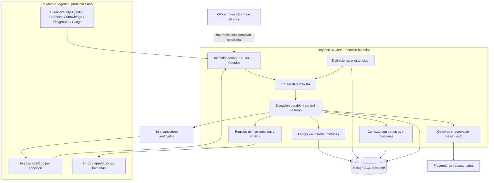
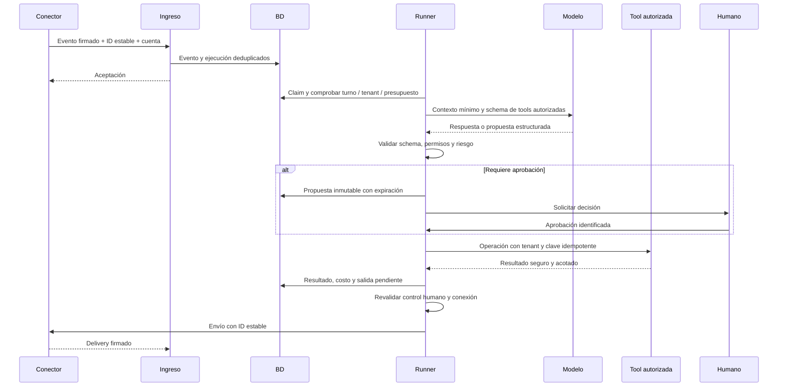

# 03 — Arquitectura objetivo

**I — propuesta, no implementada.** Evidencias del punto de partida en 01/02; referencias C identificadas abajo. Prioridad: compatibilidad, seguridad y un solo camino de ejecución medible.

## Separación de productos y responsabilidades

**Reymen AI Core** será un conjunto de módulos internos del monolito Next.js/PostgreSQL: gateway/budget/ledger, registro de especialistas, policy engine, ejecución de herramientas, routing, contexto, observabilidad y trabajos. No nuevo repositorio, microservicio, broker o proveedor por defecto. Las tareas durables pueden usar tablas/claims PostgreSQL y runner con el mecanismo cron existente, sin hacer esperar al POS.

**Reymen AI Agents** será el producto externo: catálogo/activación, canales, conocimiento, Playground, uso y operación humana por organización. Las rutas y módulos actuales siguen funcionando detrás de adaptadores durante migración.

**Reymen Office** queda fuera: futuro consumidor de interfaces Core con identidades, permisos, almacenes lógicos y presupuestos separados. No usar un “tenant interno universal” que pueda leer datos de clientes ni reusar tokens de canal externos. Si Office requiere código/procesos arbitrarios, necesita análisis de aislamiento propio antes de habilitar herramientas.

## Qué reutilizar y qué construir

**C:** gateway y reserva ya están en [gateway](../../src/lib/ai/gateway.ts), [budget](../../src/lib/ai/budget.ts). Inbox/Conversation/Message, RBAC, módulos y DomainEvent existen. DomainEvent no es hoy la cola de inferencia AUTO: reusar el patrón no implica que ese enlace ya esté hecho. [schema](../../prisma/schema.prisma#L1488), [automation-tick](../../src/lib/automation-tick.ts).

| Límite | Responsabilidad propuesta | Reutilización / cambio |
|---|---|---|
| Agent Registry | Definición global versionada e instancia del tenant | Nuevo modelo; adapter WhatsAppAssistant/Rulebook; sin hardcode de Mark en teléfono |
| Channel Gateway | Cuenta externa, identidad confiable, capacidades de envío y salud | Adapter de webhooks/n8n; conexión explícita nueva, mantener rutas firmadas |
| Router | Resolver instancia habilitada y autorizada | Nuevo determinista; elegir una instancia inicial por conexión/intención, no LLM obligatorio |
| Context Service | Historial acotado, CRM autorizado, fuentes asignadas y revisión | buildDraftMessages/Rulebook reutilizados con separación política/datos y permisos |
| Tool Registry | Schema, permiso, riesgo, ejecución, idempotencia y resultado seguro | Wrappers de servicios CRM/agenda; no ejecutar Server Action como si el modelo tuviera sesión humana |
| Execution Runner | Claim, lease, pasos, deadline, resultados y salida durable | Patrones PostgreSQL/advisory lock/outbox; versión de conversación; no depender solo de after |
| Approval/Handoff | Identidad del aprobador, precondiciones, expiración y transferencia | Reusar auditoría y acciones sugeridas CRM; generalizar sin perder historial |
| Usage | Costos por llamada y conversación única; cuota comercial separada | Extender AiUsage con agentInstanceId y rootExecutionId opcionales, conservar agentKey histórico |

## Catálogo inicial propuesto

Todos son **I**, no funciones ya disponibles. Activar un especialista exige permisos, fuentes y contrato comercial; “disponible” no significa ejecutándose.

| Especialista | Capacidades y límite inicial | Aprobaciones / dependencia |
|---|---|---|
| Mark, comunicación | FAQ, intención simple, contexto autorizado, respuesta y humano | AUTO por canal explícito; ninguna mutación financiera; reglas no cubiertas derivan |
| Alex, ventas | Consultar CRM, calificar, proponer oportunidad/seguimiento/propuesta | Crear/avanzar según política aprobada; cierre y envío comercial sensible con humano; no clonar pipeline actual |
| Nora, soporte | Consultar pedido/incidencia, responder soporte | Ticket write solo cuando exista servicio validado; no asumir tabla de tickets existente; reembolso siempre humano |
| Cora, reservas | Disponibilidad, preparar reservar/cancelar | Reutilizar Appointment/Service/AvailabilityRule; validar choque en BD, confirmación antes de reservar/cancelar según política |
| Mia, marketing | Borradores y análisis de campaña | Publicar o ejecutar campaña siempre requiere aprobación ligada a contenido/destinatarios; consentimiento verificado |
| Atlas, analítica | Indicadores/reportes de tenant autorizados | Solo lectura, consultas predefinidas; sin SQL libre ni datos de otra organización |

Nombre interno (Mark) distinto de nombre público (Sofía). Se conserva el nombre actual del negocio como candidato de publicName, sin sobrescribirlo durante migración. Número/cuenta es propiedad de ChannelConnection del tenant.

## Orquestación mínima

Comparación de patrones:

| Patrón | Decisión y motivo |
|---|---|
| Single-agent con herramientas | MVP de Mark; un ciclo controlado, menor costo y trazabilidad simple |
| Router + especialistas | Añadir al habilitar Alex; reglas primero, clasificación LLM solo con ambigüedad justificada |
| Supervisor LLM por mensaje | Posponer; añade llamadas/errores sin caso de negocio demostrado |
| Handoff directo | Sí, mediante transición autorizada, no conversación libre entre agentes |
| Workflow determinista | Sí para aprobación, reserva, seguimiento o envío; reutilizar reglas existentes |
| Async | Sí para tareas largas, análisis y recuperación durable; no bloquear cobro POS |

Flujo de decisión: tenant de conexión → permiso/módulo/plan → canal y estado humano → instancia activa → intención/regla → fuentes/tools permitidas → presupuesto → ejecución. Modelo nunca asigna tenant ni autoriza acceso. Si no hay instancia apta, continuar humano; no activar especialista automáticamente.

Límites iniciales propuestos (configurables, no actuales): máximo 4 pasos totales por raíz, 2 llamadas LLM, 2 herramientas y 1 handoff entre especialistas; profundidad 1, sin volver al agente ya visitado; una respuesta final por turno; deadline 90s (proveedor ≤60s, herramienta lectura 5s, escritura 10s). Presupuesto se reserva por llamada y además por raíz; exceder límite deriva con resumen seguro. Establecer límites inferiores en canal que lo requiera tras pruebas; no garantizan latencia de proveedor.

Timeout de lectura idempotente: hasta 2 reintentos con backoff dentro del deadline. Escritura/envío ambiguo: consultar resultado por clave; no repetir sin reconciliar. Nuevo mensaje mientras inferencia: invalidar salida obsoleta o replanificar bajo versión. Handoff transfiere resumen autorizado y IDs, no historial entero ni secretos. Conflicto entre especialistas: responsable único por ejecución; humano decide si no hay regla determinista.

## Estimación de reutilización

**I:** estimación por capacidades, no por LOC, tiempo completado o calidad certificada. Denominador: estas **20 capacidades** necesarias para MVP comercial. 1 = base suficiente para adaptar, 0.5 = parcial, 0 = nueva; no significa que las de 1 no tengan hallazgos.

| Capacidad | Puntaje | Evidencia C o motivo |
|---|---:|---|
| Sesión/tenant | 1 | auth/session-guard |
| RBAC y módulos | 1 | permissions/modules; guardias requieren corregir H01 |
| Inbox/historial | 1 | Conversation/Message |
| Contrato n8n genérico | 1 | org-webhook-route/n8n |
| Gateway/proveedores | 1 | ai/gateway/providers |
| Ledger/tarifas | 1 | AiUsage/AiRate |
| Reserva presupuestal | 1 | ai/budget |
| Auditoría | 1 | AuditLog/logAudit |
| CRM/servicios de negocio | 1 | pipeline/CRM/agenda |
| Componentes visuales | 1 | ui/shared/portal |
| Reglas y fuentes reutilizables | 0.5 | Rulebook/KnowledgeBase sin asignación/versiones |
| Guardrails de respuesta | 0.5 | regex/JSON y humano; falta policy de tools |
| Trabajos durables IA | 0.5 | patrones cron/outbox existentes, no unidos a AUTO |
| Pruebas/evaluaciones | 0.5 | tests existentes; falta Playground fiel |
| Handoff/control de turno | 0.5 | estado escalado; falta reconciliación/ownership |
| Entitlements comerciales agentes | 0.5 | cap actual por canal necesita compatibilidad |
| Catálogo/instancias | 0 | nuevo |
| Grants y Tool Registry | 0 | nuevo |
| Routing multiespecialista | 0 | nuevo |
| Registro de conexión por cuenta | 0 | nuevo |
| **Total** | **13/20 = 65 %** | Rango de planificación 55–75 % |

Incertidumbre: madurez real de conectores externos, datos legacy y hallazgos de concurrencia pueden cambiar el puntaje. No extrapolar 65% a “65% implementado” del producto completo ni al marketplace.
