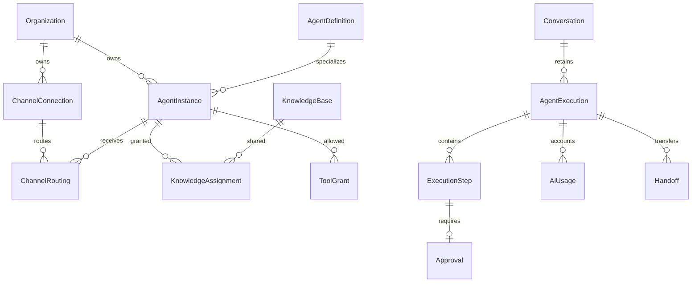

# 04 — Modelo de datos y migración

**I — diseño exclusivamente. No contiene migraciones ejecutables.** No se crearon tablas ni se consultaron datos reales. Contratos de campos son propuestas que deben contrastarse con inventario y pruebas autorizadas.

## Mapeo de entidades y relaciones

**C:** modelos existentes referenciados en [schema:862](../../prisma/schema.prisma#L862), [972](../../prisma/schema.prisma#L972), [2102](../../prisma/schema.prisma#L2102), [2306](../../prisma/schema.prisma#L2306).

| Concepto | Entidad actual | Evolución propuesta |
|---|---|---|
| Identidad del asistente | WhatsAppAssistant, 1/org | Adapter legacy. AgentInstance.publicName preserva nombre; teléfono pasa lógicamente a conexión, sin borrar columna antigua inicialmente |
| Instrucciones | BusinessRulebook; Prompt/PromptVersion históricos | Rulebook común de negocio con revisiones; instrucciones específicas/versionadas en instancia. Evaluar reutilizar PromptVersion para instrucciones sin confundir tipos legacy |
| AgentDefinition | Sin equivalente exacto | Registro global key, version, specialty, displayName, capability manifest. Ningún dato privado tenant en definición |
| AgentInstance | Sin equivalente exacto | orgId, definitionKey/version, publicName, status, configVersion, config, legacyAssistantId opcional; única org+definition para MVP |
| ChannelConnection | phoneNumber en asistente y credenciales privadas n8n | orgId, channel, externalAccountKey, status, credentialRef, capabilities, health timestamps. Solo referencia a secreto, no enviarlo al navegador |
| ChannelRouting | AgentChannelSetting org+canal | Conservar modo legacy; routing org+connection+intent+prioridad → agentInstance. Una ruta default no ambigua por conexión |
| Capability / Tool | Servicios y permisos sueltos | Definición de herramientas en código; grants por instancia de operaciones/alcance/riesgo/aprobación. Evitar tabla duplicada para cada función |
| KnowledgeSource | KnowledgeBase | Reusar filas; revisar versionado aditivo y asignación org+instance+source. No copiar contenido |
| Workflow | Automation/AutomationExecution, PipelineAiRun/Action | Reusar para automatizaciones de negocio; no llamar a cada chat Automation. Workflow conversacional versionado solo si caso lo exige |
| Execution | AiUsage y PipelineAiRun parciales | Execution raíz/step persistente; AiUsage mantiene ledger por llamada, no sustituye registro de herramientas ni trabajo |
| Handoff | Conversation.status/assignedToId | Evento/registro con from/to, motivo, estado y versión; mantener historial humano y tiempos |
| Approval | PipelineAiAction SUGGESTED parcial | Propuesta con actor, hash de argumentos, policyVersion, expiración y resultado; adaptar acción CRM existente |

Diagrama conceptual **I**. Conversation y AiUsage existen; las otras relaciones nuevas no existen aún. KnowledgeBase no se renombra por capricho y las entidades legacy no se borran.

## Invariantes de almacenamiento

- Toda fila de runtime tiene organizationId; relaciones entre recursos tenant usan FK compuesta `(organizationId,id)` cuando sea viable, además de consultas scope. Ningún ID del modelo decide organización.
- Config/grants/versiones se fijan al crear ejecución; credencial se consulta en servidor al ejecutar. Revalidar revocación/módulo/estado humano antes de efectos.
- Raíz única por `(organizationId, connectionId, externalEventId, operation)`; pasos únicos por `(executionId, stepKey)`. Provider requestId estable por intento lógico, sin reutilizar para regeneración explícita.
- Conversation mantiene ID y mensajes. Añadir connectionId/externalThreadId nullable inicialmente; dedup por conexión/hilo después de resolver ambiguos. No imponer unicidad que borre hilos existentes para que “pase” la migración.
- Execution: estado QUEUED/RUNNING/WAITING_APPROVAL/WAITING_HANDOFF/SUCCEEDED/FAILED/CANCELLED; lease/attempts/nextAttemptAt/deadline/lastErrorCode. Outbound con estado de aceptación separado de delivery.
- AiUsage conserva requestId, tarifas, FX, agentKey, conversationId históricos; añadir agentInstanceId/rootExecutionId opcionales e índices org+fecha+agente. Un registro por llamada, no por visita de pantalla.
- Conocimiento versionado, estado publicado y grants; borrar/desactivar revoca retrieval futuro. Ejecución guarda referencias/revisiones, no copia indiscriminada del documento en logs.
- Retención: aprobar política por tipo de dato. No eliminar compras, clientes, conversaciones o métricas por introducir agentes. Soft-delete con auditoría cuando aplique, no cascada masiva accidental.
- Nuevo límite comercial separado de maxAiAgents legacy. No convertir seis canales existentes en seis especialistas facturados.

## Contratos propuestos (no endpoints actuales)

Mantener Server Actions para UI interna salvo necesidad de API externa. Firmar y versionar los contratos de conectores; no reemplazar rutas actuales de golpe.

| Operación propuesta | Entrada mínima | Invariante |
|---|---|---|
| list/getAgentInstance | ID o filtro local | tenant viene de contexto, no del formulario |
| updateAgentInstance | id, configVersion esperada, publicName/config | manage + módulo + validación; 409 lógico por versión obsoleta |
| setAgentGrants | id, lista de capabilities/sources | IDs deben pertenecer a tenant y permisos del administrador |
| connectChannel / updateRouting | connectionId, ruta, expectedVersion | cuenta única coherente y destino activo; no aceptar secretos en cliente |
| runPlayground | modo test, fixture, instanceVersion | herramientas mock/read-only, presupuesto separado; sin efecto externo |
| approveExecutionStep | stepId, proposalHash, decision | rol, expiración y precondiciones; ejecución única |
| getExecutionTrace | executionId | redacción de PII y scope; sin credenciales/prompts privados ajenos |

Los nombres son interfaces de diseño. En fase autorizada se decide cuáles necesitan `/api/...`; no prometer URLs que no existen.

## Plan de migración seguro

1. **Inventario de solo lectura autorizado:** commit desplegado, versión de esquema, cantidades/hash de nombres/reglas/prompts/modes por tenant, cuentas conectadas, datos de laboratorio histórico, ledger y derechos del plan. Exportar sin secretos; guardar manifest protegido. Identificar organizaciones con personalizaciones/conflictos.
2. **Backup y restauración de ensayo:** copia cifrada y verificación de restauración en BD aislada; medir RTO/RPO reales. El respaldo previo de otra tarea no sustituye respaldo de la futura migración.
3. **Expandir aditivamente:** tablas/campos nullable e índices cuidadosamente planificados; probar bloqueos en copia. Código viejo sigue leyendo sus tablas. No renombrar/drop ni reescribir ledger.
4. **Adapter legacy primero:** lectura de configuración existente, mismos modos/nombres/conocimiento. Flag org desactivado por defecto. Distinguir estado “legacy” de instancia Mark aprobada.
5. **Backfill idempotente por lotes:** dry-run con diffs; checkpoint, límites y validación de referencias. Mantener mapa legacy→nuevo, no inferir cuentas de números libres. Colas ambiguas se revisan manualmente. Crear propuesta de instancia, no activación automática.
6. **Comparación shadow sin efectos:** comparar contexto/config/routing resultante; cero envío/CRM/consumo duplicado. Si se usan dos modelos para evaluación, contar/capear ambos explícitamente en presupuesto de prueba, nunca ejecutar dos salidas.
7. **Piloto explícito por tenant:** confirmar publicName, canales, reglas, efectos CRM y límites comerciales; activar solo uno con monitoreo y humano de respaldo. No migrar a Mark automáticamente.
8. **Cutover por tenant:** una única ruta de escritura autoritativa. Evitar dual-write independiente; si puente necesario, transacción local + outbox idempotente para sincronización. Eventos de distintas versiones deben entenderse durante coexistencia.
9. **Validar integridad:** counts por tenant y tabla, hashes de texto, FKs, `distinct conversation`, sumas de AiUsage por día/modelo, estados abiertos/escalados y callbacks pendientes. Diferencias justificadas, cero pérdida permitida.
10. **Retiro posterior:** tras periodo acordado y evidencia, quitar lecturas viejas primero. Eliminación de columnas/tablas es tarea futura con aprobación específica, nunca parte implícita del piloto.

## Rollback y fallos

Rollback de aplicación/flag conserva tablas nuevas y ledger. Pausar nuevas ejecuciones, conciliar las ya aceptadas y volver adapter legacy solo cuando no existe salida pendiente conflictiva. Mantener compatibilidad de payload/versiones de n8n. Desactivar especialista no apaga Inbox/POS/CRM manual.

No restaurar una copia antigua encima de producción para revertir UI: perdería ventas/conversaciones posteriores. Restauración completa solo para desastre bajo runbook aprobado, con recuperación de eventos posteriores y RPO acordado. Acciones ya enviadas no se “desenvían”; registrar compensación/notificación humana. Preservar IDs externos para evitar duplicar al cambiar de runtime.

## Riesgos y gates

| Riesgo | Gate previo al piloto |
|---|---|
| Campos greeting/personality/capabilities legacy no usados por runtime nuevo | Revisar contenido por tenant; no desechar ni asumir vacío |
| Prompts y laboratorio históricos con datos | Inventario/mapping independiente; conservar versiones/resultados |
| Teléfono libre no identifica cuenta real | Verificar cuenta en conector antes de asignar connectionId |
| Conversaciones fusionadas por teléfono o escaladas | Resolver ambigüedad sin borrar; escenarios H03 |
| Callback tardío de versión anterior | Contrato compatible y transición monotónica |
| Cambio semántico del plan | Aprobación comercial y grandfathering explícito |
| Backfill lento/bloqueante | Lotes, ensayo de volumen, pausa/reinicio y métricas |
| Campos config presentes en logs | Redacción por allowlist y acceso auditado |

**V:** volúmenes, downtime tolerable, SLA, cuentas externas y mapeos reales siguen pendientes. Sin ellos no aprobar migración de producción.

## Expansión implementada en Fase 1

[13](13_IMPLEMENTACION_FASE_1.md) especifica las seis tablas implementadas, FKs compuestas, restricciones de referencias legacy y snapshot de admisión. El resto de este documento conserva el diseño objetivo; no implica que conexiones, grants, approvals, ledger por especialista o cutover estén implementados.

## Expansión local de Fase 3

[15](15_IMPLEMENTACION_FASE_3.md) implementa ChannelConnection/ChannelRouting, binding nullable de Conversation e índice parcial de propiedad confirmada. Las migraciones se aplicaron solo en bases sintéticas. No hay backfill automático ni cutover real. El binario nuevo requiere expandir esquema previamente, incluso con el flag apagado; el rollback preferido conserva el binario y pausa el flag, sin dejar que un sender viejo ignore cuentas ya vinculadas.

## Seguimiento de Fase 4

Se reutiliza `KnowledgeBase` como fuente única y se añaden `KnowledgeRevision`, `KnowledgeGrant` y `KnowledgeAccessPolicy`. Las revisiones conservan contenido histórico; no se crean copias por asistente ni se equiparan artículos con PromptVersion. No hay backfill/publicación/asignación automática. Ver [16_IMPLEMENTACION_FASE_4.md](16_IMPLEMENTACION_FASE_4.md) para FKs, esquema requerido y rollback sin borrar datos.

## Inicio de Fase 5

Se añade AgentSandboxRun para recibos de prueba con clave organización/actor/requestKey, hash/versiones, claim, cancelación y expiración. AgentExecution legacy y las sesiones de prompts no cambian. No se crea una instancia real de Mark ni una tabla de consumo paralela. Ver [17_INICIO_FASE_5_MARK.md](17_INICIO_FASE_5_MARK.md).
