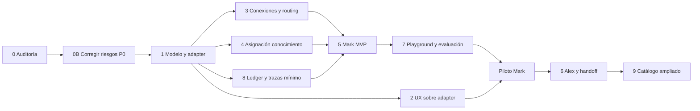

# 07 — Roadmap de implementación propuesto

**I — no autorizado ni iniciado.** Fase 0 documental es la única ejecutada. Estimaciones en días-persona efectivos (ingeniería + revisión + QA), incertidumbre ±40%; no fechas comprometidas ni incluyen espera de aprobación Meta/OAuth o descubrimiento de datos legacy. Prioridades relativas: P0 seguridad/compatibilidad, P1 MVP, P2 expansión.

## Dependencias y orden recomendado

Se adelantan seguridad, conocimiento y telemetría respecto del orden comercial del prompt: no habilitar un especialista sin permisos/fuentes/costos. El arnés seguro de pruebas de fase 7 empieza en 0B; la UI completa llega después. Fase 8 divide ledger mínimo (pre-piloto) y analítica comercial posterior. Dependencias pueden desarrollarse en paralelo solo cuando se autorice equipo/alcance; no significan ejecución simultánea ahora.

## Fase 0 — Auditoría e inventario

- **Objetivo/alcance:** rastreo de código y diseño, estos 12 documentos; inventario de datos y conectores queda pendiente, no se ejecutó.
- **Archivos/reutilización:** `docs/ai-agents/*`; referencias a componentes/servicios actuales.
- **BD/API propuestas:** ninguna en esta fase.
- **Riesgos/dependencias:** snapshot puede diferir de main/VPS; acceso de lectura al despliegue para cerrar V, sin secretos.
- **Pruebas/aceptación:** 18 checks aislados; documentos y enlaces verificables; límites explícitos. No certificado de producción.
- **Rollback/esfuerzo/prioridad:** retirar documentación si se requiere; etapa documental completada, estimación futura inventario 2–3 d; **P0**.

## Fase 0B — Correcciones previas de seguridad y ejecución

- **Objetivo:** cerrar H01–H06/H08/H11 aplicables al piloto y dar cobertura de regresión.
- **Alcance:** guardias RBAC/módulo, errores terminales y escalamiento, control humano, identidad de conversación, contrato webhook, conciliación de costo desconocido; preservar operación legacy.
- **Archivos afectados:** `src/actions/{knowledge-base,whatsapp-assistant,rulebook,conversations}.ts`, `src/lib/{ai-auto-reply,webhook-processors,webhook-ingest,webhook-retry,ai-pipeline}.ts`, `src/lib/ai/{gateway,budget}.ts`, rutas n8n y tests.
- **Reutiliza:** auth/can/modules, AuditLog, Prisma transacciones, dedup y tests existentes.
- **BD/API:** evaluar estado durable de ejecución/entrega aditivo en fase 1; schemas de input y errores explícitos sin romper contratos antiguos. No inventar migración antes de revisar datos.
- **Riesgos/dependencias:** cambiar búsqueda de hilos requiere reconciliar ambiguos; coordinación con n8n; entorno desechable autorizado.
- **Pruebas:** matriz roles/direct actions, concurrentes, error proveedor, humano durante llamada, duplicate/out-of-order, modelo efectivo y fallos ledger.
- **Aceptación:** cero writes denegados; trabajo aceptado termina/deriva; una salida por turno; ningún dato ajeno ni canal equivocado; costos desconocidos visibles.
- **Rollback:** flag por ruta/canal, revertir código compatible; conservar nuevos estados/auditoría; conciliar mensajes ya enviados. No restaurar BD antigua.
- **Esfuerzo/prioridad:** **8–14 d, P0**.

## Fase 1 — Modelo de agentes y compatibilidad

- **Objetivo/alcance:** definición/instancia, adapter legacy, configVersion y Execution/steps durables; preservar derechos de planes.
- **Archivos:** `prisma/schema.prisma`, futuras migraciones aditivas autorizadas, nuevo `src/lib/ai/agents/*` (propuesto), `src/lib/{agent-mode,agent-cap,rulebook}.ts`, `src/lib/plans.ts`.
- **Reutiliza:** WhatsAppAssistant, AgentChannelSetting, BusinessRulebook, permisos/módulos, ledger/outbox patterns.
- **BD/API:** tablas del documento 04; nullable pointers, constraints tenant; interfaces list/update/activate/configure como Server Actions, API externa solo si necesaria.
- **Riesgos/deps:** legado personalizado, cap por canal, datos históricos; depende de inventario/0B y decisión comercial de entitlements.
- **Pruebas:** backfill dry-run/idempotente, dos tenants, viejo/nuevo código, snapshot config y rollback por tenant.
- **Aceptación:** sin flag comportamiento igual; no activar Mark ni cambiar nombre/canal/cupo silenciosamente; conteos/hash iguales.
- **Rollback:** volver adapter legacy, mantener tablas/IDs nuevas, pausar claims nuevos y conciliar pendientes.
- **Esfuerzo/prioridad:** **6–10 d, P0**.

## Fase 2 — Nueva interfaz AI Agent Center

- **Objetivo/alcance:** Overview/My Agents/perfil y navegación, cuatro estados, móvil/a11y/ES-EN; mantener enlaces viejos.
- **Archivos:** `src/app/(portal)/portal/{whatsapp,knowledge-base,ai-lab,ai-usage}/*`, `src/components/portal/*`, `src/lib/portal-nav-tabs.ts`, i18n; nuevos componentes según 05.
- **Reutiliza:** PortalShell, PageHeader/Card/Button/Badge/MetricCard/EmptyState, preferencias y Radix.
- **BD/API:** no nuevo almacenamiento por diseño visual; consume acciones fase 1; no habilitar botones de herramientas inexistentes.
- **Riesgos/deps:** overflow/flash/foco, confundir agente/canal; depende adapter y contrato de estados.
- **Pruebas:** 320–1280px, zoom, claro/oscuro, teclado/lector, permisos, offline y reintento; grids n1–9.
- **Aceptación:** usuario distingue conexión/modo/agente; navegación anterior preservada; sin scroll horizontal accidental; última card solitaria completa fila.
- **Rollback:** flag de navegación, UI anterior compatible con mismos datos.
- **Esfuerzo/prioridad:** **6–10 d, P1**.

## Fase 3 — Separación de Channels

- **Objetivo/alcance:** cuenta por org, salud comprobable, routing y contratos normalizados, empezar un canal piloto; no afirmar seis conectores listos.
- **Archivos:** schema, `src/lib/{channels,n8n,org-webhook-route,webhook-processors}.ts`, `src/app/api/webhooks/n8n/*`, UI Channels propuesta, documentación contratos.
- **Reutiliza:** HMAC/timestamp/dedup, Inbox/Message, callbacks y conectores n8n existentes verificados.
- **BD/API:** ChannelConnection/ChannelRouting; connectionId/thread IDs opcionales durante transición; versión de payload/evento; acciones de conexión/ruta.
- **Riesgos/deps:** OAuth/scopes/expiración/ventanas/proveedor, hilos ambiguos; fase1 y export saneado del canal.
- **Pruebas:** firma del proveedor y tenant, reconexión, eventos fuera de orden, dos cuentas mismo número/contacto, media segura, humano/disable.
- **Aceptación:** número pertenece al canal y estado real es visible; canal no conectado no aparenta estar activo; compatible con emisor legacy.
- **Rollback:** routing viejo para org piloto tras drenar/conciliar; credenciales antiguas no revocadas antes de validación.
- **Esfuerzo/prioridad:** **5–9 d base + 2–5 d por conector adicional verificado; P0 base, P1 canales**. Aprobaciones externas fuera de estimación.

## Fase 4 — Knowledge Access por agente

- **Objetivo/alcance:** compartir fuentes sin duplicación, grants/revisión/publicación, retrieval medible y límites visibles.
- **Archivos:** schema, `src/lib/rulebook.ts`, `src/actions/knowledge-base.ts`, `src/app/api/v1/knowledge-base/route.ts`, componentes KB/perfil.
- **Reutiliza:** KnowledgeBase/BusinessRulebook; evaluar PromptVersion para instrucciones, no forzar equivalencia con documentos.
- **BD/API:** assignments y revisiones aditivas; acciones de publicar/asignar; retrieval recibe instancia derivada de contexto autorizado.
- **Riesgos/deps:** inyección/PII/coste de contexto, borrar fuentes usadas; fase1 y H01 corregido.
- **Pruebas:** 9+ artículos, truncado, fuentes revocadas, cross-tenant, tags, versiones concurrentes y golden FAQ.
- **Aceptación:** una fuente física compartida; solo fuentes autorizadas; calidad y costo medidos; no añadir embeddings sin evidencia de necesidad.
- **Rollback:** adapter fuente legacy por tenant conservando revisiones/grants; comparar respuestas antes de cambiar.
- **Esfuerzo/prioridad:** **5–8 d, P0 permisos / P1 UX y recuperación**.

## Fase 5 — Mark MVP y herramientas

- **Objetivo/alcance:** comunicación segura, herramientas inicialmente lectura, turno único, humano y entregas durables.
- **Archivos:** nuevos módulos `src/lib/ai/{agents,tools,execution}` propuestos, gateway/contexto, `ai-auto-reply.ts`, `ai-draft.ts`, inbox.
- **Reutiliza:** generateText/budget/AiUsage, servicios CRM, historial y handoff actual adaptado.
- **BD/API:** grants/tool steps/approval según04; no SQL ni herramientas arbitrarias; acciones para estado/trace bajo RBAC.
- **Riesgos/deps:** efectos dobles/prompt injection/costos; requiere1/3/4/8 mínimo, P0 cerrados y QA seguro.
- **Pruebas:** límite pasos/timeout, spoof tenant, revoke, failover, pausa humana, envíos ambiguos, mensajes externos con instrucciones maliciosas.
- **Aceptación:** una respuesta final por turno, lectura mínima, fallback humano; pruebas no tocan producción; piloto no aumenta errores/costo fuera de umbral acordado.
- **Rollback:** detener Mark y volver legacy tras reconciliar outbox; mensajes entregados no se deshacen.
- **Esfuerzo/prioridad:** **7–12 d, P1**.

## Fase 6 — Alex y delegación

- **Objetivo/alcance:** ventas especializadas y un handoff controlado; migrar capacidades de pipeline sin duplicar automatizaciones.
- **Archivos:** `src/lib/ai-pipeline.ts`, `src/actions/ai-pipeline.ts`, registry/router/tools/execution propuestos, `LeadAgentActions`.
- **Reutiliza:** PipelineAiRun/Action, oportunidades/etapas y undo/accept/reject.
- **BD/API:** relación instancia/ejecución, Handoff y Approval; herramientas CRM explícitas y versionadas, no reescribir historial de acciones.
- **Riesgos/deps:** dos agentes cambian mismo lead, falsas oportunidades, cierres no autorizados; Mark piloto + Playground eval + políticas acordadas.
- **Pruebas:** bucle Mark→Alex→Mark denegado, máximo un handoff, conflictos humanos, consentimiento, rollback acción sin borrar cambios posteriores.
- **Aceptación:** conversación continua sin duplicar mensajes/costos; cierre con humano; pipeline legacy no ejecuta también misma capacidad.
- **Rollback:** apagar routing a Alex, mantener acciones históricas y pendientes humanas, un solo pipeline autoritativo.
- **Esfuerzo/prioridad:** **6–10 d, P1**.

## Fase 7 — Playground y evaluaciones

- **Objetivo/alcance:** single-agent, channel simulation, workflow tests; fixtures versionados, tools mock/read-only y trazas visibles.
- **Archivos:** `/portal/ai-lab`, AgentTester, actions/agent, servicios execution/context y tests; nuevo arnés seguro propuesto.
- **Reutiliza:** preview, guardrails, esquema de sandbox/testcases solo tras revisar compatibilidad real.
- **BD/API:** sesiones/resultados de pruebas aislados con environment/version; runPlayground/replay/golden grading, no efecto sobre Conversation real.
- **Riesgos/deps:** prueba accidental con tools reales/PII/costo; arnés mínimo previo a5, UI completa tras execution estable.
- **Pruebas:** adaptadores que fallan si intentan escribir/enviar, presupuesto dedicado, fixture tenant, reproducibilidad, reset en vuelo.
- **Aceptación:** etiqueta de simulación fiel, costo explícito cuando proveedor real, trazas y casos repetibles; cero herramientas de producción.
- **Rollback:** mantener probador antiguo con copy corregido; preservar casos creados.
- **Esfuerzo/prioridad:** **5–8 d, P0 arnés / P1 UI**.

## Fase 8 — Usage, Analytics y costos

- **Objetivo/alcance:** attribution por instancia/modelo/canal, raíz y conversación únicas, unknown/estimated/confirmed, snapshots y costos internos separados del precio.
- **Archivos:** schema, `src/lib/ai/{gateway,budget,report,portal-usage}.ts`, admin AI/portal Usage y export.
- **Reutiliza:** AiUsage/AiRate/budget/reservations/adjustments, CSV y agrupación distinct.
- **BD/API:** pointers opcionales, snapshots de ciclo/conciliación; lecturas de analytics por tenant y export separado admin. No duplicar ledger.
- **Riesgos/deps:** atribuir historia a Mark sin evidencia, sumar conversaciones por agente, desconocido como cero, filtrar margen; fase1/H08.
- **Pruebas:** sumas por agente/modelo contra total, llamadas multiagente una conversación, FX/fallback/error, cambio plan y CSV malicioso.
- **Aceptación:** gastos auditables, histórico inmutable y PII redactada; retail no igual al costo proveedor; indicadores con definición.
- **Rollback:** lectura legacy tolera columnas nuevas; conservar todo asiento y ajuste, nunca borrar consumo para cuadrar cifras.
- **Esfuerzo/prioridad:** **5–8 d, P0 ledger mínimo / P1 analytics**.

## Fase 9 — Marketplace y especialistas

- **Objetivo/alcance:** ampliar catálogo Nora/Cora/Mia/Atlas según demanda y evals; decidir si Workflows merece navegación.
- **Archivos:** registry/capabilities/tools, catálogo/perfiles y servicios existentes específicos; billing/planes si oferta lo requiere.
- **Reutiliza:** todo Core probado; Appointment/Availability, reportes y automatizaciones antes de nuevos subsistemas.
- **BD/API:** versiones de definición y entitlement separado; no nueva tabla de tickets o canal sin justificar; APIs de capacidad según caso aprobado.
- **Riesgos/deps:** expansión de permisos/costo/contratos, marketplace de terceros no confiables; fases5–8 estables y evaluación comercial.
- **Pruebas:** suite contractual por especialista, límites/consentimiento/aprobación; Mia nunca publica sin humano; Atlas solo lectura.
- **Aceptación:** especialista aporta métrica útil y supera corpus de calidad; desactivación preserva historial y no altera los demás.
- **Rollback:** retirar del catálogo/pausar instancia sin borrar datos; drenar trabajos, mantener definición histórica.
- **Esfuerzo/prioridad:** **3–5 d catálogo + 5–10 d/especialista, P2**, tras discovery específico; fuera del MVP Mark/Alex.

## Condiciones de aprobación por fase

Cada PR futura: problema/cambio concreto, pruebas realmente ejecutadas, compatibilidad, migración aditiva revisada si existe, feature flag y rollback. Owner aprueba efecto comercial/funcional; seguridad valida permisos; operaciones valida datos/backups/delivery. Ninguna aprobación general de diseño activa producción automáticamente.

## Actualización de alcance

El propietario autorizó exclusivamente el hardening, denominado **Fase 0** en su solicitud y **Fase 0B** en este roadmap. La implementación mínima y la evidencia se registran en [12](12_IMPLEMENTACION_FASE_0.md). No se inició Fase 1 ni se crearon AgentDefinition/AgentInstance/ChannelConnection. La decisión de reutilizar WebhookEvent permitió recuperar trabajo actual sin migración de esquema.

## Autorización posterior: Fase 1

El propietario autorizó continuar con Fase 1. El modelo, adapter, flags y observación durable implementados se describen en [13](13_IMPLEMENTACION_FASE_1.md). Se conserva el runtime de Fase 0 como único autor de efectos. El inventario productivo y piloto no se ejecutaron; Fase 2 y especialistas posteriores no se iniciaron.

## Seguimiento después de Fase 2

La introducción de este documento conserva el estado de la auditoría original. Después se implementaron Fases 0/1 ([12](12_IMPLEMENTACION_FASE_0.md), [13](13_IMPLEMENTACION_FASE_1.md)) y la interfaz de Fase 2 ([14](14_IMPLEMENTACION_FASE_2.md)). La interfaz usa un flag independiente, no activa especialistas ni conexiones. Fase 3 y despliegue no se iniciaron; requieren su alcance/validación correspondiente.
