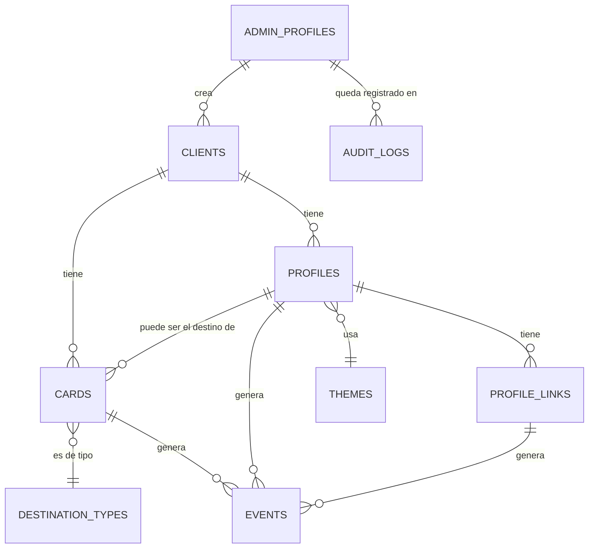

# REYMEN SmartCard — Fase 2: Supabase y base de datos

> Continúa de `ARCHITECTURE.md` (Fase 1). Este documento cubre el modelo de datos, las migraciones SQL, RLS y las funciones públicas. Todo el SQL ya fue aplicado y probado contra un Postgres 16 real (ver "Cómo se validó esto", al final) — no es solo texto, es SQL que corre.

## 1. Mapa de tablas



Ocho tablas de negocio (`clients`, `profiles`, `profile_links`, `cards`, `events`, `themes`, `audit_logs`, `admin_profiles`) más dos catálogos pequeños (`destination_types`, `reserved_slugs`). No se agregaron `card_destinations`, `subscriptions` ni `orders` — la sección 54 pedía evaluar si hacían falta, y en V1 no: los destinos ya viven en `cards.destination_type` + `destination_url`/`profile_id`, y no hay facturación ni pagos en el alcance actual.

## 2. Por qué dos tablas son catálogo en vez de ENUM o CHECK fijo

`destination_types` y `reserved_slugs` son tablas normales, no `ENUM` de Postgres ni una lista hardcodeada en una migración. La sección 9 pide explícitamente "flexibilidad para agregar nuevos tipos posteriormente" — con una tabla, agregar `COUPON` o una nueva palabra reservada es un `INSERT`, sin migración ni `ALTER TYPE`. `destination_types` además guarda `requires_profile` y `requires_url`, que es justo lo que el trigger de validación de `cards` usa para decidir qué exigir — así que agregar un tipo nuevo con las reglas típicas (requiere URL, no requiere perfil) no toca ni una línea de código de validación.

Otros campos con vocabulario fijo y poco cambiante (`status` de clientes/perfiles/tarjetas, `role` de admin, `event_type`, `source`, `device_type`) sí usan `CHECK` simple — no se espera que cambien sin pensar también el resto del sistema, así que el costo de una migración para agregarlos es aceptable y mantiene el esquema más legible.

## 3. Identificadores: UUID interno vs. código comercial

Cada tabla de negocio tiene `id UUID` como llave primaria real, usada en todos los joins. `cards` además tiene `card_code` (`REY-000001`, `REY-000002`...), generado automáticamente por un trigger que consume una `SEQUENCE` de Postgres — nunca se envía desde la aplicación en un alta normal. Es secuencial y por tanto adivinable, pero eso no es un problema de seguridad real: conocer un `card_code` solo permite ver el mismo destino público al que esa tarjeta ya apunta intencionalmente. Lo que sí queda protegido es el `id` interno, que es el que usa cualquier lógica administrativa.

## 4. Borrado: soft delete + una política de `ON DELETE` deliberadamente conservadora

`clients`, `profiles` y `cards` tienen `deleted_at`; el borrado normal es una actualización, no un `DELETE` (sección 58). Para el caso raro de un `DELETE` físico, las relaciones estructurales (`clients → profiles`, `clients → cards`, `profiles → cards`) usan `ON DELETE RESTRICT`: Postgres impide borrar un cliente o un perfil que todavía tiene tarjetas o perfiles dependientes, en vez de arrastrar un borrado en cascada silencioso (sección 57: "no quiero cascadas peligrosas por defecto"). Las relaciones desde `events` hacia sus padres (`card_id`, `profile_id`, `link_id`) usan `ON DELETE SET NULL`, porque un evento es un hecho histórico que debe sobrevivir aunque la fila que lo originó desaparezca — el historial de analítica nunca debe romperse (requisito explícito de la sección 58). `profile_links` sí usa `ON DELETE CASCADE` desde `profiles`, porque un link no tiene sentido propio sin su perfil.

Un detalle más fino: el `slug` de `profiles` es único **solo entre perfiles activos** (índice único parcial `WHERE deleted_at IS NULL`), así que un slug queda libre para reutilizarse si el perfil original se da de baja. `card_code`, en cambio, es único **siempre**, sin importar `deleted_at` — un código ya pudo haberse impreso en una tarjeta física en el mundo real, y reasignarlo sería peligroso aunque la fila esté "borrada" en la base de datos.

## 5. Seguridad: nada de acceso directo para el rol público

Esta es la pieza más importante de la fase. Ninguna tabla tiene una sola política de RLS para el rol `anon`. Sin política, RLS deniega por defecto — y se verificó en la práctica (sección 8) que una consulta directa de `anon` contra `clients`, `cards` o `events` falla limpiamente con "permission denied", nunca devuelve una fila.

Todo el acceso público real pasa por cuatro funciones `SECURITY DEFINER`:

- `get_card_for_redirect(card_code)` — lo que necesitan las rutas `/n/{code}` y `/q/{code}` para decidir qué hacer.
- `get_public_profile(slug)` — el perfil completo con sus links activos y el theme resuelto, en una sola llamada.
- `get_vcard_data(slug)` — solo los campos que un archivo `.vcf` necesita.
- `log_event(...)` — el único camino para escribir en `events`; internamente resuelve `card_code` o `slug` a los IDs correctos y hace el `INSERT`.

Cada una devuelve exactamente los campos de ese caso de uso, nunca la fila completa — es la respuesta concreta (a nivel de base de datos, no solo de convención de código) a la sección 99: "no usar `SELECT *` indiscriminadamente en APIs públicas". `notes` de `clients`, por ejemplo, es estructuralmente imposible de ver desde el frontend público, porque ninguna función pública lo selecciona y ninguna policy le da acceso directo a la tabla.

Para el panel administrativo (`authenticated`), la autorización es por rol de negocio: una función `current_admin_role()` lee `admin_profiles` y cada policy compara contra `'SUPERADMIN'`, `'ADMIN'` o `'VIEWER'` (sección 19). SUPERADMIN puede todo, incluido borrar (`DELETE`) y gestionar `themes`/usuarios; ADMIN puede crear y editar clientes/perfiles/tarjetas pero no borrar ni gestionar usuarios ni themes; VIEWER solo lee, en todas las tablas de negocio y en `events`. `audit_logs` es de solo lectura para SUPERADMIN y no tiene ninguna política de `UPDATE`/`DELETE` — es inmutable por construcción, no por convención.

**Hallazgo real durante la verificación:** la primera versión de `current_admin_role()` solo tenía permiso de ejecución para `authenticated`, no para `anon`. El efecto no era una fuga de datos, pero sí un fallo confuso: una consulta de `anon` contra una tabla protegida moría con un error interno de Postgres ("permission denied for function current_admin_role") en lugar de un rechazo limpio a nivel de tabla. Se corrigió otorgando el `EXECUTE` también a `anon` (que de todas formas siempre recibe `NULL` de esa función, porque nunca tiene fila en `admin_profiles`), y se confirmó que ahora el rechazo es el esperado ("permission denied for table ..."), consistente con lo que un cliente PostgREST necesita para responder con un 401/403 limpio.

## 6. Privacidad de analítica: sin columna de IP

`events` no tiene ninguna columna de dirección IP. La sección 15 pide explícitamente cuidado con la privacidad y evitar guardar IP completa si no es necesaria — y para lo que este producto necesita (contar escaneos y clics, no perseguir usuarios individuales) `occurred_at` + `user_agent` + `card_id`/`profile_id` ya son suficientes. Si en el futuro se necesita investigar un caso puntual de abuso, la fuente correcta son los logs de Nginx (rotados, fuera de la base de datos de producto), no una columna nueva aquí — así la decisión de privacidad no depende de que nadie recuerde anonimizar algo cada vez que se lee la tabla.

`is_bot` marca eventos de bots/crawlers/previews conocidos (sección 42): se guardan igual, mismo detalle que el resto, pero quedan disponibles para excluirse de las métricas que ve el cliente sin perder el dato en bruto.

## 7. Índices

Los mínimos que las rutas calientes y los filtros del panel realmente usan (sección 56): `profiles.slug` (único parcial), `cards.card_code` (único, ya viene del constraint), `events.card_id`, `events.profile_id`, `events.occurred_at`, un compuesto `(profile_id, occurred_at)` para los filtros por perfil y rango de fechas del panel, `events.event_type`, y los `client_id`/`profile_id` de las tablas que se listan por cliente o perfil en el panel.

## 8. Cómo se validó esto

No es solo SQL escrito y revisado a ojo: se aplicó contra un Postgres 16 real en este mismo entorno, con un stub mínimo del esquema `auth` de Supabase (`auth.users`, `auth.uid()`, roles `anon`/`authenticated`) para poder probarlo sin depender todavía de un proyecto Supabase en la nube. Se confirmó en la práctica:

- Las 14 migraciones y el seed aplican sin errores, en orden, desde cero.
- `get_public_profile`, `get_card_for_redirect`, `get_vcard_data` y `log_event` devuelven exactamente los datos esperados para los casos `REY-000001` (perfil) y `REY-000002` (Google Reviews) del seed.
- El trigger de slugs reservados rechaza `admin` como slug.
- El trigger de validación de destino rechaza `PROFILE` sin `profile_id` y `WHATSAPP` sin `destination_url`.
- El índice único parcial rechaza un slug duplicado entre perfiles activos.
- Un nuevo `card_code` se autogenera correctamente (`REY-000003`) cuando no se envía.
- `anon` no puede leer `clients`, `cards` ni `events` directamente — y tras el hallazgo de la sección 5, el rechazo es limpio, no un error interno.

Este stub de `auth` y la base de datos de prueba se descartaron al terminar — no forman parte del entregable ni deben aplicarse contra Supabase real.

## 9. Aplicar esto contra el proyecto Supabase real

Una vez confirmes el proyecto Supabase (pendiente de la sección 10 de `ARCHITECTURE.md`):

```bash
npm install -g supabase
supabase login
supabase link --project-ref <tu-project-ref>
supabase db push          # aplica las 14 migraciones de supabase/migrations/ en orden
```

`supabase/seed.sql` es solo para desarrollo local (`supabase start` + `supabase db reset`, que lo corre automáticamente) — no debe ejecutarse contra producción; ahí las primeras tarjetas reales se dan de alta desde el panel, no por seed.

Para generar los tipos TypeScript que usará `packages/database` en Fase 3:

```bash
supabase gen types typescript --project-id <tu-project-ref> > packages/database/types.ts
```

## 10. Pendiente explícito antes de Fase 3

La creación del primer SUPERADMIN (sección 67) todavía no está resuelta aquí a propósito — depende del flujo de autenticación, que es Fase 4. Con este modelo ya es posible insertar manualmente una fila en `auth.users` vía el dashboard de Supabase y su `admin_profiles` correspondiente con `role = 'SUPERADMIN'`, pero el proceso completo (invitación, primer login, cambio de contraseña) se detalla cuando lleguemos a esa fase.

## 11. Próximos pasos

Fase 3, según la sección 88 del documento original: scaffolding del monorepo Next.js (`apps/public`, `apps/admin`, `packages/database` con los clientes Supabase — browser/server/admin — y los tipos generados aquí).
